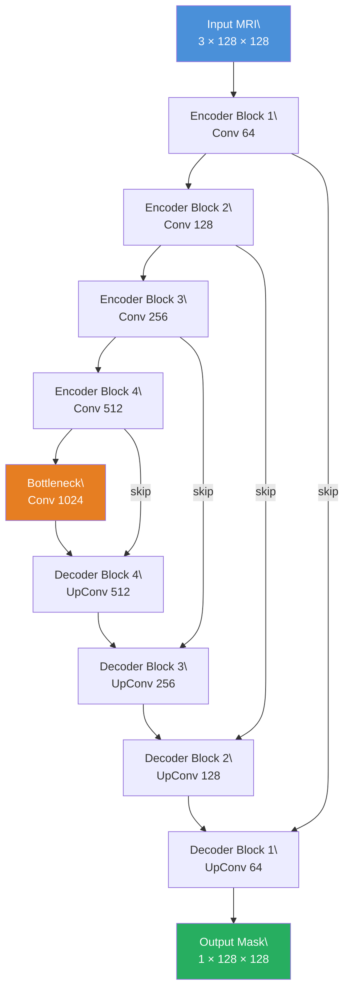
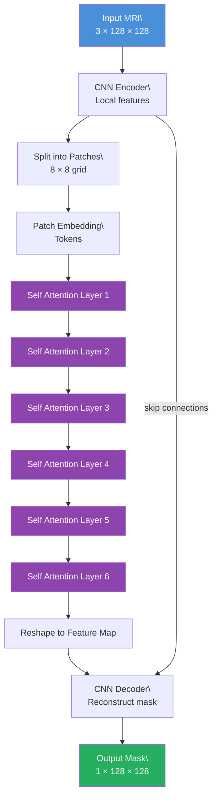
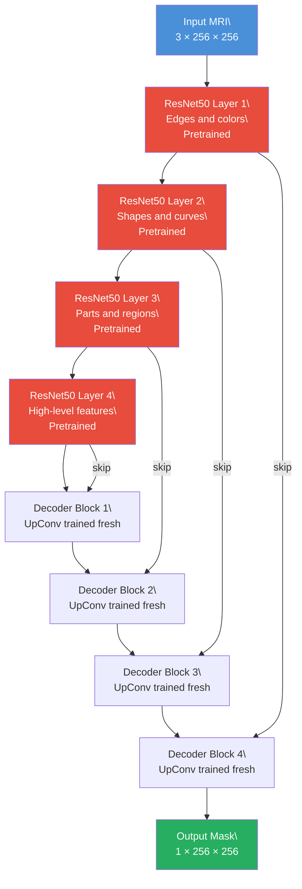
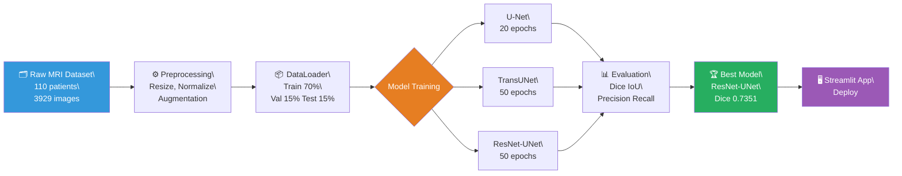

"""# 🧠 Brain Tumor Segmentation using Deep Learning

  
### Automatic pixel-level tumor segmentation from brain MRI scans
### using three deep learning architectures

---

## 📌 Overview

Brain tumor segmentation identifies **exactly which pixels** in an MRI scan belong to a tumor.

| Task | Output | Example |
|------|--------|---------|
| Classification | Label | "Tumor present" |
| Detection | Bounding box | Rectangle around tumor |
| **Segmentation** ← this project | Pixel mask | Exact tumor region highlighted |

This project implements and compares **3 deep learning architectures**, trains them on real MRI data, and deploys the best model as a **Streamlit web app**.

---

## 🏆 Results

| Model | Dice ↑ | IoU ↑ | Precision ↑ | Recall ↑ |
|-------|:------:|:-----:|:-----------:|:--------:|
| U-Net (baseline) | 0.5164 | 0.3758 | 0.4340 | 0.7582 |
| TransUNet | 0.6525 | 0.5264 | 0.6152 | 0.8097 |
| **ResNet50-UNet** ⭐ | **0.7351** | **0.6178** | **0.7610** | **0.7535** |

> 🚀 ResNet50-UNet achieved **42% improvement** in Dice Score over U-Net baseline using pretrained ImageNet encoder.

---

## 🧬 Architecture

### 1️⃣ U-Net — Baseline

**Key idea:** Skip connections pass encoder features directly to decoder — preserving fine spatial details lost during downsampling.

**Limitation:** CNN only sees local regions — misses global tumor shape context.

---

### 2️⃣ TransUNet — CNN + Vision Transformer

**Key idea:** Transformer attends to every patch simultaneously — understands global tumor context that CNN misses.

**Result:** Fewer false positives, better boundary detection. Dice 0.5164 → 0.6525 (+26%)

---

### 3️⃣ ResNet50-UNet — Transfer Learning ⭐ Best

**Key idea:** Encoder pretrained on 1.2M ImageNet images — already knows visual patterns. Only decoder trained from scratch on MRI data.

**Result:** Fastest convergence, best performance. Dice 0.5164 → 0.7351 (+42%)

---

### 🔄 End-to-End Pipeline

---

## 📦 Dataset

**[LGG Brain MRI Segmentation](https://www.kaggle.com/datasets/mateuszbuda/lgg-mri-segmentation)** — Kaggle

- 110 patients, 3929 MRI slices
- Image size: 256×256 RGB
- Binary labels: tumor (1) vs background (0)
- Class split: 34% tumor / 66% no tumor
- Dataset split: 70% train / 15% val / 15% test

---

## 🗂️ Project Structure

brain-tumor-segmentation/
│
├── src/
│ ├── dataset.py ← PyTorch Dataset + augmentation pipeline
│ ├── models.py ← UNet, TransUNet, ResNet50-UNet definitions
│ └── metrics.py ← Dice, IoU, Precision, Recall functions
│
├── models/ ← saved model weights
│ ├── best_unet.pth
│ ├── best_transunet.pth
│ └── best_smp_unet.pth
│
├── outputs/ ← prediction visualizations + results
│ ├── unet_predictions.png
│ ├── transunet_predictions.png
│ └── final_results.json
│
├── app.py ← Streamlit web application
├── requirements.txt ← all dependencies
└── README.md

---

## 🔮 Future Work

- [ ] Train on full BraTS 2020 dataset (25,000 slices)
- [ ] Multi-class segmentation (tumor core, enhancing, edema)
- [ ] 3D volumetric segmentation
- [ ] Deploy on HuggingFace Spaces
- [ ] Add GradCAM visualizations for explainability
- [ ] Test with EfficientNet and ViT encoders

---

## 📄 References

- [TransUNet: Transformers Make Strong Encoders for Medical Image Segmentation](https://arxiv.org/abs/2102.04306)
- [U-Net: Convolutional Networks for Biomedical Image Segmentation](https://arxiv.org/abs/1505.04597)
- [LGG Segmentation Dataset — Kaggle](https://www.kaggle.com/datasets/mateuszbuda/lgg-mri-segmentation)
- [segmentation-models-pytorch](https://github.com/qubvel/segmentation_models.pytorch)

---

## 🛠️ Tech Stack

`PyTorch` `segmentation-models-pytorch` `albumentations`
`OpenCV` `Google Colab` `NumPy`

---

"""

with open('/content/brain_tumor_segmentation/README.md', 'w') as f:
    f.write(readme_content)

print("✅ README.md written successfully")
print(f"✅ Total characters: {len(readme_content):,}")
